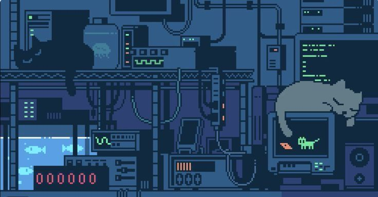

<div align="center">



[](https://skillicons.dev)


</div>

---

## 👋 Hey there, I'm Justin

I'm Carl Justin Agapito, a full stack developer based in Sipalay City, Philippines. I build web applications with **ASP.NET Core**, **Laravel**, and **React**, from database design and REST APIs to the UI on top.

> *"First, solve the problem. Then, write the code."*

---

## 🛠️ What I Work With

**Backend**
- 🟣 **C# / ASP.NET Core** + **Entity Framework Core**: REST APIs and data access
- 🔴 **Laravel** (PHP): scalable APIs and full-stack web apps with Inertia.js

**Frontend**
- ⚛️ **React** + **TypeScript**: type-safe, component-driven UIs
- 🎨 **Tailwind CSS**, **React Admin**, **Vite**

**Data & Tools**
- 🗄️ **MySQL**, **SQL**
- 🧰 Git, GitHub, Composer, npm, Cloudflare (deployment)

---

## 🚀 Projects

### 🌟 Stellar Path v2: OJT Management System
`Laravel 13` · `Inertia.js` · `React 19` · `TypeScript` · `Tailwind CSS v4` · `MySQL`
- 33-table database supporting school, student, and company portals
- Role-based access control with 29 permissions
- 64 automated tests covering application behavior

### 🌐 Personal Portfolio
`React` · `TypeScript` · `Vite` · `Cloudflare`

---

## 📊 Skills Snapshot

| Area | Technologies |
|------|-------------|
| 🌐 Full-Stack Web | ASP.NET Core · Laravel · React · TypeScript |
| 🔧 Backend | C# · PHP · REST APIs · Entity Framework Core · MVC |
| 🎨 Frontend | React · TypeScript · Tailwind CSS · Inertia.js |
| 🗄️ Data | MySQL · SQL · Database Design |
| 🔐 Practices | Role-Based Access Control · Automated Testing · Debugging |

---

## 🌱 Current Chapter

```csharp
// Justin's current focus
using System;

class Justin
{
    static void Main()
    {
        string status   = "Full Stack Developer, open to opportunities";
        string stack    = "ASP.NET Core + Laravel + React + TypeScript";
        string learning = "Brushing up on Python";
        string goal     = "Become a more well-rounded dev";

        Console.WriteLine($"Status:   {status}");
        Console.WriteLine($"Stack:    {stack}");
        Console.WriteLine($"Learning: {learning}");
        Console.WriteLine($"Goal:     {goal}");
    }
}
```

---

## 📫 Let's Connect

<div align="center">

Feel free to reach out. I'm always open to cool projects and good conversations.

[](https://github.com/Justin-Agapito)
[](https://linkedin.com/in/carl-agapito-3706a4348)
[](mailto:carlj.agapito@gmail.com)

</div>

---

<div align="center">

*Thanks for stopping by! ⚡*

</div>
